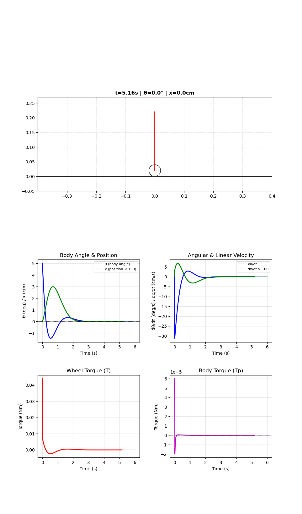

# Python Simulation & Visualization

<p align="center"></p>

This folder provides a Python port of the MATLAB models in `matlab/` for the foc-wheel-legged-robot.

Features:
- Kinematics and VMC mapping of the leg (`leg_pos`, `leg_spd`, `leg_conv`)
- Discrete LQR controller computed via scipy (stable closed-loop control)
- Linearized dynamics builder using sympy symbolic differentiation
- Robust matplotlib animations with dynamic viewport following
- Stability analysis and eigenvalue diagnostics

## Setup (conda env)

Use your conda environment `robot-env` (already wired by VS Code steps):

```bash
# If needed: activate your env manually in a terminal
conda activate robot-env
# Install deps
python -m pip install -r requirements.txt
```

## Quick test

```bash
# From repo root or the python/ folder
python python/smoke_test.py
```

Expected output ends with shapes of A/B and Ad/Bd.

## Demos

Run from the `python/` folder so `robot_sim` is importable:

```bash
# Leg kinematics animation
python -m robot_sim.demos.leg_kinematics_demo

# Balance linear model closed-loop simulation + animation
python -m robot_sim.demos.balance_sim_demo
```

If matplotlib is using a non-GUI backend (e.g., over SSH), set:

```bash
export MPLBACKEND=Agg  # to save figures instead of showing windows
```

## Module overview

- `robot_sim/leg.py` — Kinematics, Jacobian (finite-diff), VMC mapping
- `robot_sim/lqr.py` — `lqr_k(L0)` polynomial fit (for reference; use `compute_dlqr` instead)
- `robot_sim/system.py` — Build linear model via sympy, discretize, compute DLQR gain, simulate
- `robot_sim/visualize.py` — Matplotlib drawing/animation with dynamic viewport
- `robot_sim/demos/` — Example scripts
  - `leg_kinematics_demo.py` — Animated leg geometry
  - `balance_sim_demo.py` — Full balance controller simulation

## Utilities

- `smoke_test.py` — Quick import and function test
- `balance_preview.py` — Generate non-GUI preview image
- `debug_stability.py` — Eigenvalue analysis and stability check

## Dependencies

Install via:
```bash
pip install -r requirements.txt
```

Required packages:
- **numpy** ≥ 1.22 — Array operations
- **matplotlib** ≥ 3.5 — Visualization
- **sympy** ≥ 1.10 — Symbolic differentiation for linearization
- **scipy** ≥ 1.8 — Discrete LQR solver (`solve_discrete_are`)
